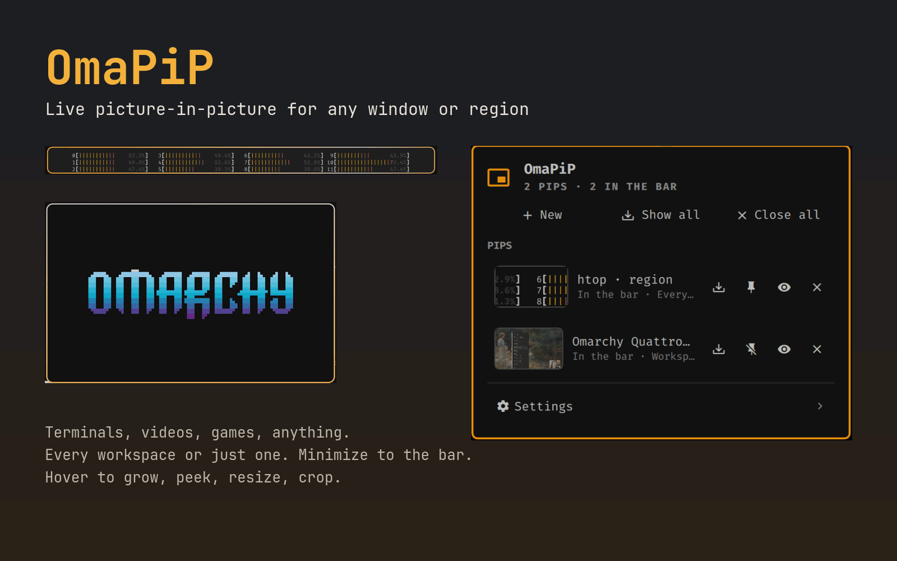

# OmaPiP

Live picture-in-picture for anything on your Omarchy desktop: a whole window, a corner of a window, or any region of the screen. Pick it and it floats above everything in a small live window. A terminal running a build, a game, a video in the browser, a dashboard, a chat: if it's on screen, it can be a PiP.



## What it does

- **Any window, even when you leave it.** Click a window and its PiP keeps updating live when you switch to another workspace, when the window is hidden behind others, or when it sits on another monitor.
- **Any region.** Drag a rectangle. If it falls inside one window, the PiP shows just that part of that window and follows it wherever it goes (resize the window and the crop holds). If it spans several windows, it mirrors that part of the screen.
- **Several at once.** Up to 12 PiPs. New ones stack by the starting corner.
- **Every workspace or just one.** Each PiP stays on every workspace or belongs to the workspace it was made on, where it slides away and back as you switch. Change it any time with the pin button.
- **Tucked into the bar.** Dock a PiP and it flies into the bar icon and becomes a live thumbnail beside it. Hover the thumbnail for a large live preview; click it and the PiP flies back out.
- **Very animated.** PiPs fly out of the region you picked, ripple when they land, grow toward the middle of the screen on hover, pop their buttons in one by one, spin a gradient border, and implode when closed. Set Animation to *Calm* for the shell's own understated motion, and `omarchy toggle animations` turns all of it off.

## Use

| Where | Action | What happens |
| --- | --- | --- |
| Bar icon | Right click | Pick a new PiP |
| Bar icon | Click | Open the panel: every PiP, and the settings |
| Bar icon | Middle click | Dock every PiP into the bar, or bring them all back |
| Picker | Click a window | PiP of that window |
| Picker | Drag | PiP of that region |
| Picker | `S` / `Enter` / `Esc` | Whole screen / what is highlighted / cancel |
| PiP | Drag | Move it; it snaps to edges and corners |
| PiP | Wheel / `Ctrl`+wheel | Resize / change opacity |
| PiP | Double click | Jump to the source window |
| PiP | Right click / middle click | Dock it in the bar / close it |
| PiP | Hover | Buttons: go to source, click through, opacity, every workspace or one, dock, close |
| Thumbnail | Hover / click / middle click | Large preview / restore / close |

The three bar icon clicks can be reassigned in the settings.

A PiP set to **click through** lets every click pass to what is underneath. Turn it back from the panel.

### Keyboard shortcuts

OmaPiP answers on the shell's IPC, so any key can drive it. For example, in `~/.config/hypr/bindings.lua`:

```lua
o.bind("SUPER + ALT + P", "New PiP", "omarchy-shell omapip pick")
o.bind("SUPER + ALT + O", "Dock or show PiPs", "omarchy-shell omapip toggle")
```

| Command | What it does |
| --- | --- |
| `omarchy-shell omapip pick` | Open the picker |
| `omarchy-shell omapip toggle` | Dock every PiP, or show them all |
| `omarchy-shell omapip dockAll` / `showAll` / `closeAll` | What they say |
| `omarchy-shell omapip list` | The PiPs, as JSON |
| `omarchy-shell omapip settings` | The settings, as JSON |
| `omarchy-shell omapip set <key> <value>` | Change a setting |

## Settings

Open the panel and unfold **Settings**, or edit `~/.config/omapip/settings.json` (it reloads on save), or use `omarchy-shell omapip set`.

| Key | Values | Default |
| --- | --- | --- |
| `visibility` | `all`, `workspace`: where new PiPs show | `all` |
| `size` | `small`, `medium`, `large`: starting width | `medium` |
| `corner` | `tl`, `tr`, `bl`, `br`: where new PiPs land | `br` |
| `hover` | `grow`, `ghost` (fades so you can see under it), `dodge` (jumps to the other side; hold `Alt` to grab it), `none` | `grow` |
| `hoverScale` | 1.05 to 2.5 | 1.35 |
| `opacity` | 0.15 to 1 | 1 |
| `radius` | -1 (follow Hyprland's rounding) to 64 | -1 |
| `border` | `gradient`, `accent`, `none` | `gradient` |
| `animation` | `calm`, `lively`, `extreme` | `extreme` |
| `refresh` | `live`, `1`, `5` (seconds between frames, to save power) | `live` |
| `layer` | `top`, `overlay` (also above fullscreen windows) | `top` |
| `background` | `theme`, `transparent`: behind translucent windows | `theme` |
| `thumbs` | live thumbnails of docked PiPs in the bar | `true` |
| `peek` | large preview when hovering a thumbnail | `true` |
| `shadow` | | `true` |
| `snap` | snap to edges and corners | `true` |
| `hideWhenSourceVisible` | hide a window's PiP while the window itself is on screen | `false` |
| `closeWhenSourceCloses` | | `true` |
| `paintCursor` | draw the pointer in the PiP | `false` |
| `leftClick`, `middleClick`, `rightClick` | `panel`, `pick`, `toggle` | `panel`, `toggle`, `pick` |

## Install

```sh
omarchy plugin add https://github.com/avillagran/omapip --enable
```

The bar icon goes to the right section; move it like any other widget.

### Requirements

Omarchy 4.x with its Quickshell shell and Hyprland. Everything OmaPiP uses ships with Omarchy: Quickshell's screen capture, `omarchy-shell`, and `omarchy-notification-send`. Node.js is needed only to run the tests.

## Remove

```sh
omarchy plugin remove io.github.avillagran.omapip
```

Then delete `~/.config/omapip/` and `~/.local/state/omapip/` if you want its settings and saved PiPs gone too.

## What it does on your system

- Captures windows and screen regions with Quickshell's built-in screen copy, inside the shell, only while a PiP, thumbnail or preview shows them. Nothing is recorded, saved to disk, or sent anywhere.
- Reads the window list from Hyprland to know which window is where, and asks Hyprland to focus a window when you double-click its PiP.
- Writes two files: `~/.config/omapip/settings.json` and `~/.local/state/omapip/pips.json` (which windows and regions you have as PiPs, and where). PiPs of windows that no longer exist are dropped from it.
- Sends one notification, with fixed text, if you try to open more than 12 PiPs.
- Runs no other commands and makes no network requests.

## Development

```sh
tests/run          # logic and catalog tests
scripts/dev-sync   # copy the working tree into ~/.config/omarchy/plugins for live testing
```

Changes to `Service.qml` need `omarchy restart shell` to take effect; the shell keeps the old service loaded otherwise.
